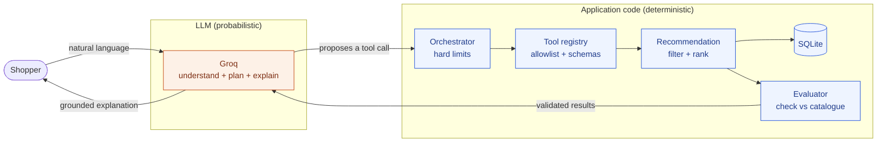
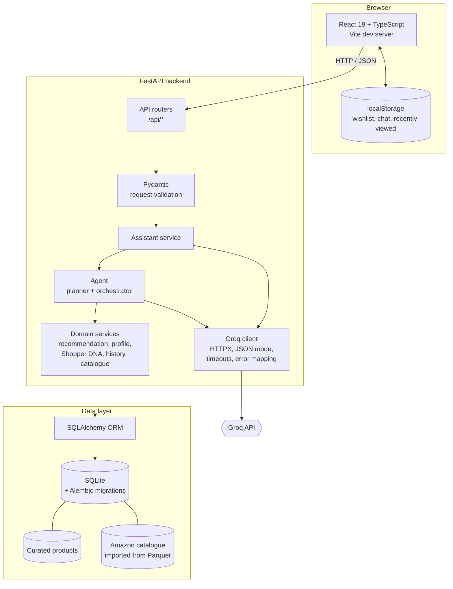
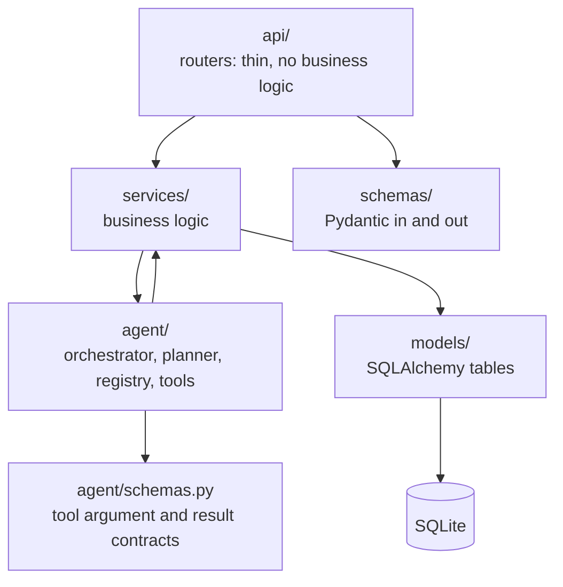
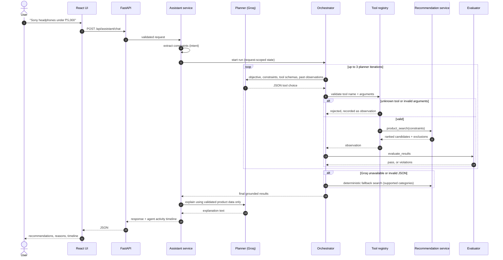
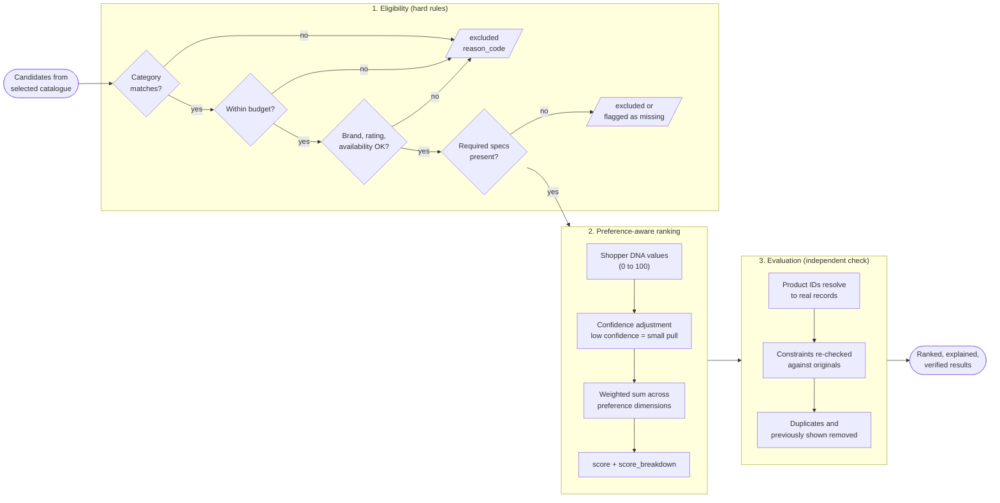
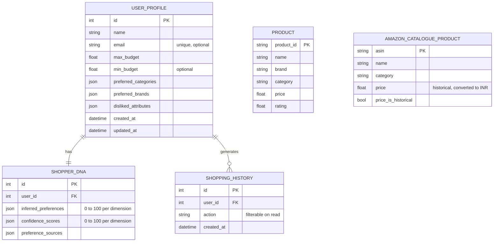
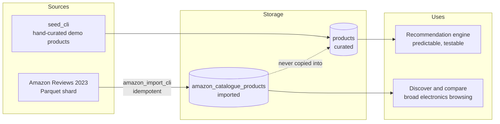

# SmartShopper AI

**A shopping assistant that plans with an LLM and decides with code.**

[](#)
[](#)
[](#)
[](#)
[](#)
[](#)

SmartShopper takes a shopping request written in plain English, such as *"wireless headphones under ₹5,000 with good battery life, Sony preferred"*, turns it into structured constraints, runs a bounded set of tools against a product catalogue, and returns ranked, explained recommendations.

The LLM decides **what to do next**. It never decides **which products exist** or **which ones pass the budget**. Those decisions are deterministic, validated, and tested.

<!-- Add a screenshot or GIF of the Shop With AI page and the agent timeline here -->

---

## Table of contents

- [Why it's built this way](#why-its-built-this-way)
- [Architecture](#architecture)
- [How an agent request flows](#how-an-agent-request-flows)
- [Recommendation pipeline](#recommendation-pipeline)
- [Data model](#data-model)
- [Two catalogues, kept apart](#two-catalogues-kept-apart)
- [Features](#features)
- [Tech stack](#tech-stack)
- [Project structure](#project-structure)
- [Getting started](#getting-started)
- [API reference](#api-reference)
- [Testing](#testing)
- [Design decisions](#design-decisions)
- [Limitations](#limitations)
- [Roadmap](#roadmap)
- [How AI was used in this project](#how-ai-was-used-in-this-project)
- [License](#license)

---

## Why it's built this way

Most LLM shopping demos ask the model to recommend products directly. That means it can invent SKUs, prices, and specs. SmartShopper splits the work so that each part does what it is good at.



The practical result: every recommendation traces back to a catalogue record and a scoring breakdown, and the model cannot invoke anything outside the registry.

---

## Architecture

### System context



### Backend layers



Routers stay small and delegate to services. Services hold the rules. The agent reaches the same services through registered tools, so the planner and the REST API share one implementation of each rule.

---

## How an agent request flows

A single `POST /api/assistant/chat` call goes through the steps below. The orchestrator enforces two limits per request: at most **5 tool executions** and at most **3 planner iterations**.



Each request gets its own state object, which holds the constraints, the observations, and the execution history. One user's request cannot leak into another's.

---

## Recommendation pipeline

Recommendations are produced by code, not by the model. The pipeline has three stages.



**Confidence adjustment.** Shopper DNA stores a preference value and a confidence value for each dimension. The effective value is pulled toward a neutral midpoint in proportion to confidence, so an uncertain signal cannot dominate the ranking:

$$
P_{\text{effective}} = 50 + \bigl(P_{\text{inferred}} - 50\bigr)\cdot\frac{C}{100}
$$

For example, an inferred comfort preference of 90 with 80% confidence becomes $50 + 40 \times 0.8 = 82$.

**Simulation** runs the same pipeline with temporary preference values and returns the result without writing to the saved profile or Shopper DNA.

---

## Data model



The curated `PRODUCT` table and the imported `AMAZON_CATALOGUE_PRODUCT` table are separate on purpose. Field lists above are abbreviated to the ones that matter for the design. Check `backend/app/models/` for the full schema.

---

## Two catalogues, kept apart



The curated set makes recommendations reproducible for demos and tests. The Amazon set gives breadth for discovery. Keeping them separate means a product's source is always known.

---

## Features

**Agentic shopping assistant**
- Natural-language requests with follow-up questions that keep the earlier context
- Allowlisted planner, bounded orchestration, and request-scoped state
- Deterministic fallback when Groq is unavailable, times out, or returns invalid JSON
- Agent activity timeline showing which tools ran for each answer

**Recommendations**
- Preference-aware ranking across comfort, brand loyalty, price sensitivity, quality, portability, and battery life
- Each score broken down by component in the response
- Excluded products returned with a reason code, so you can see why something was left out
- Shopper DNA with confidence scores, so weak signals move the ranking less

**Comparison and discovery**
- Compare two or three products using only attributes that exist in the catalogue
- Missing specs are reported, never assumed
- Browse the Amazon Electronics catalogue by category
- Recently viewed products

**Profile and personal data**
- Preferences: budget range, categories, brands, disliked attributes
- Simulation: test "what if I cared more about comfort?" without changing the saved profile
- Wishlist and shopping history

---

## Tech stack

| Layer | Technologies |
|---|---|
| Frontend | React 19, TypeScript, Vite, Tailwind CSS, Lucide React |
| Backend | Python 3.11+, FastAPI, Pydantic, SQLAlchemy, Uvicorn |
| Database | SQLite, Alembic |
| LLM | Groq API (planning, intent extraction, explanation) |
| Data | Pandas, PyArrow (Parquet import) |
| Testing | Pytest, Vitest-style frontend checks, ESLint and build |

---

## Project structure

```
SmartShopper/
├── backend/
│   ├── app/
│   │   ├── agent/
│   │   │   ├── tools/              product search, comparison, profile, simulation, evaluator
│   │   │   ├── orchestrator.py     execution loop and limits
│   │   │   ├── planner.py          Groq-backed tool selection
│   │   │   ├── tool_registry.py    allowlist and argument validation
│   │   │   ├── schemas.py          tool contracts
│   │   │   └── state.py            request-scoped state
│   │   ├── api/                    FastAPI routers
│   │   ├── services/               recommendation, profile, Shopper DNA, history, catalogue, Groq client
│   │   ├── models/                 SQLAlchemy models
│   │   ├── schemas/                Pydantic request and response models
│   │   ├── data/                   seed and Amazon import CLIs
│   │   └── core/                   configuration and defaults
│   ├── alembic/                    migrations
│   ├── tests/                      pytest suite
│   └── scripts/                    Groq smoke tests and diagnostics
├── frontend/
│   └── src/
│       ├── pages/                  Discover, Shop With AI, Preferences, Saved, History
│       ├── components/             recommendation cards, chat, comparison, profile panel
│       ├── hooks/                  assistant chat, product details, health
│       ├── services/               API client, wishlist, recently viewed
│       └── types/                  TypeScript contracts
└── docs/                           architecture, data model, design system
```

---

## Getting started

**Requirements:** Python 3.11+, Node.js 20+, npm, and a Groq API key.

### 1. Backend

```bash
cd backend
python3 -m venv .venv
source .venv/bin/activate        # Windows: .venv\Scripts\activate
pip install -r requirements.txt

cp .env.example .env             # add your Groq key to this file
alembic upgrade head
python -m app.data.seed_cli      # loads the curated demo catalogue

uvicorn app.main:app --reload --host 127.0.0.1 --port 8000
```

- Health check: http://127.0.0.1:8000/api/health
- Interactive API docs: http://127.0.0.1:8000/docs

### 2. Frontend

In a second terminal:

```bash
cd frontend
npm install
cp .env.example .env
npm run dev
```

Open http://localhost:5173. Vite proxies `/api` requests to the backend.

### 3. Amazon catalogue (optional)

The full Parquet file is not in the repository because of its size.

1. Get the source shard from https://amazon-reviews-2023.github.io/
2. Place it at `backend/app/data/full-00000-of-00010.parquet`
3. Run:

```bash
cd backend
python -m app.data.amazon_import_cli --dry-run   # preview only
python -m app.data.amazon_import_cli             # import
```

Supported flags: `--limit`, `--usd-to-inr` (default ₹85 per USD), `--source`.

> **Data caveat:** Amazon prices are historical source values converted at a fixed, illustrative rate. The app does not fetch live prices and does not verify inventory or availability.

---

## API reference

| Method | Route | Purpose |
|---|---|---|
| `POST` | `/api/profiles` | Create a shopper profile |
| `GET` / `PUT` | `/api/profiles/{user_id}` | Read or update preferences |
| `GET` / `PUT` | `/api/profiles/{user_id}/dna` | Read or update Shopper DNA |
| `POST` | `/api/recommendations` | Ranked, explained recommendations for a profile |
| `POST` | `/api/assistant/chat` | Conversational shopping request |
| `POST` | `/api/history` | Record a shopping event |
| `GET` | `/api/history/{user_id}` | List history, optional `action` filter |
| `GET` | `/api/products` | Browse the curated catalogue |
| `GET` | `/api/discover/products` | Browse the Amazon Electronics catalogue |
| `GET` | `/api/health` | Health check |

### Try the core flow

**1. Create a profile**

```bash
curl -X POST http://127.0.0.1:8000/api/profiles \
  -H "Content-Type: application/json" \
  -d '{
        "name": "Demo Shopper",
        "max_budget": 5000,
        "preferred_categories": ["headphones"],
        "preferred_brands": ["Sony"],
        "disliked_attributes": []
      }'
```

**2. Get recommendations**

```bash
curl -X POST http://127.0.0.1:8000/api/recommendations \
  -H "Content-Type: application/json" \
  -d '{
        "user_id": 1,
        "category": "headphones",
        "limit": 5,
        "min_rating": 4.0
      }'
```

The response includes:
- `products`: ranked items with `score`, `reasons`, and `score_breakdown`
- `excluded_products`: each with a `reason_code`
- `explanation_summary`

**Error handling:** invalid input returns `422` with field-level detail, unknown users return `404`, and a duplicate email returns `409`.

---

## Testing

```bash
cd backend
pytest
```

The suite covers:

| Area | What is checked |
|---|---|
| API routes | Status codes, response shape, error handling |
| Schemas | Bounds, blank values, budget consistency, unknown fields |
| Agent | Tool allowlisting, execution and iteration limits, failure handling |
| Recommendations | Eligibility rules, ranking, exclusions, cross-catalogue behaviour |
| Groq client | Timeouts, rate limits, malformed responses, missing key |
| Catalogue | Import behaviour, seeding, relationships |

Most tests are negative tests: unknown tool names, out-of-range arguments, duplicate comparison IDs, missing product specs, and simulated provider failures.

Frontend:

```bash
cd frontend
npm run build
npm run lint
```

---

## Design decisions

**Why SQLite?** It needs no server, so the project runs from a single clone and a seed command. SQLAlchemy and Alembic mean moving to PostgreSQL is a configuration change, not a rewrite.

**Why an allowlisted tool registry instead of letting the model call functions?** The planner's output is parsed as JSON and checked against Pydantic schemas before anything executes. An unknown tool name is rejected, so the model cannot trigger arbitrary backend behaviour.

**Why bounded execution?** A loop with no limit can run up cost and get stuck. Five tool calls and three planning rounds per request keep behaviour predictable.

**Why deterministic ranking?** Recommendations have to be explainable and testable. Each component of the score is visible in `score_breakdown`, so a result can be checked by hand.

**Why not vector search or LangGraph?** The workflow is a small, fixed set of tools over structured fields such as budget, brand, and rating, and a relational query handles that directly. Semantic search would be a sensible next step for free-text descriptions, and a graph framework would earn its place only with more complex, multi-agent workflows.

**Why keep the catalogues apart?** Mixing a reproducible demo set with a broad imported set would make it impossible to say where a product's data came from.

---

## Limitations

- Prices and availability come from a historical dataset, not live retailers.
- The curated catalogue is intentionally small.
- Preference inference is simple and does not yet learn from clicks or saves.
- SQLite suits local use and demos, not multi-instance deployment.
- There is no authentication yet. The API is intended for local use.

---

## Roadmap

- [ ] Live retailer integrations for current prices and stock
- [ ] Semantic search over product descriptions
- [ ] Feedback loop, so Shopper DNA updates from clicks and saves
- [ ] PostgreSQL and containerised deployment
- [ ] Authentication for multi-user hosting

---

## How AI was used in this project

I designed and built SmartShopper as an academic and portfolio project. I used AI tools as assistants along the way, and I want to be specific about where they helped.

- **ChatGPT** helped me compare design options, such as custom orchestration versus a framework, and drafted parts of this documentation, which I then rewrote and checked against the code.
- **GitHub Copilot** helped with boilerplate, repetitive test cases, and autocomplete while I was writing code.

The decisions were mine: the split between LLM planning and deterministic execution, the tool allowlist and execution limits, the data model, the ranking approach, and the checks in the evaluator. I wrote and rewrote the core logic, reviewed every suggestion before accepting it, and rejected the ones that were wrong or didn't fit the design. Tests were run locally, and failures were investigated rather than accepted.

---

## License

Add your license here.
